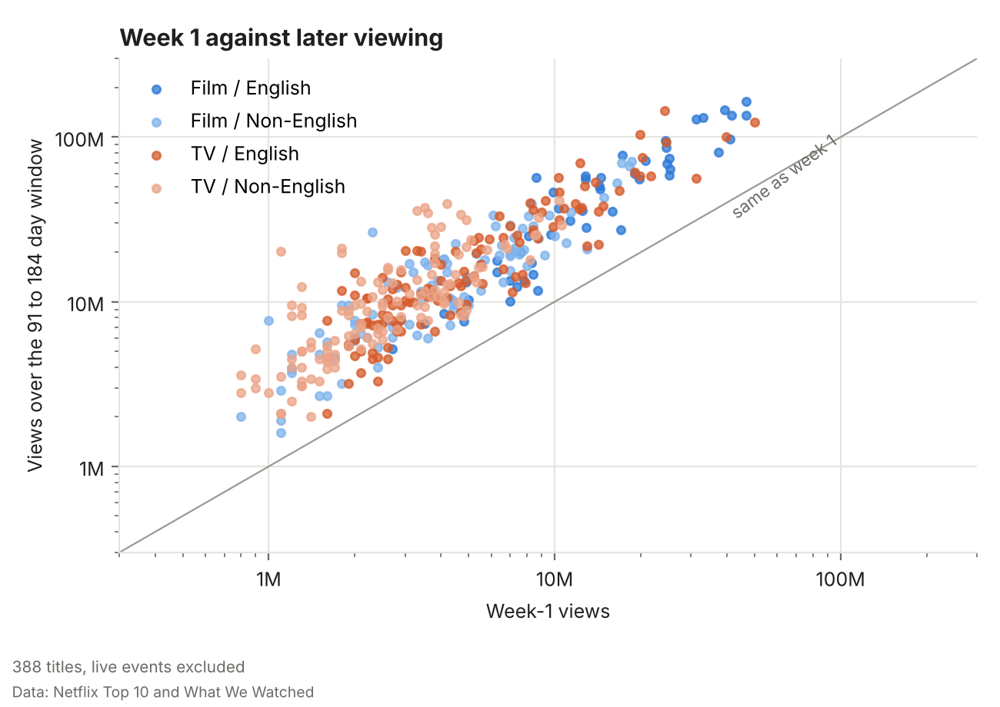
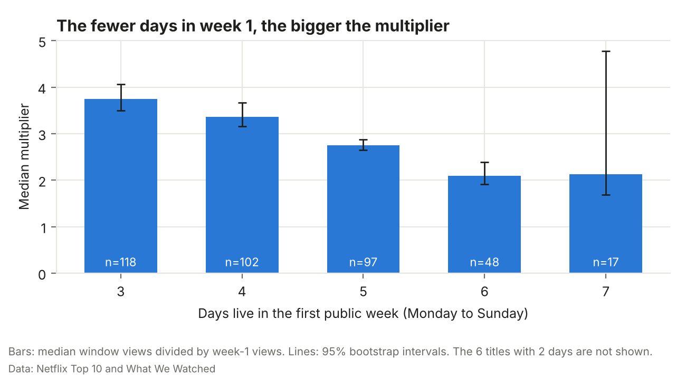
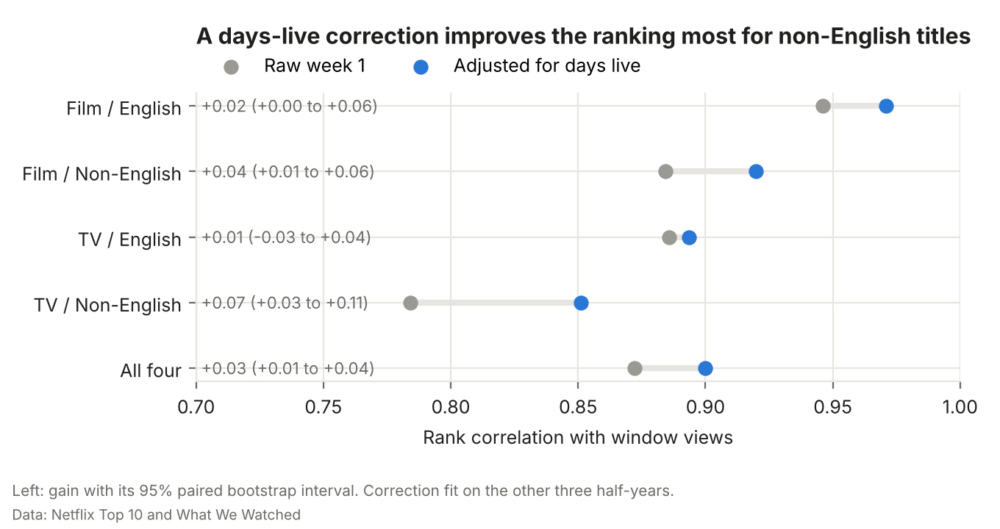

# Is week 1 a good proxy for a Netflix title's later viewing?

A proxy-metric study on Netflix's public viewing data. How well do a title's week-1 views from the weekly Top 10 predict its views over the next three to six months? Where does the proxy work, where does it break, and how noisy is it?

This uses the public numbers only. Netflix has daily data and can count from the hour a title goes live. The public week runs Monday to Sunday.



## Data

All public, all from Netflix:

- The weekly global Top 10 (`all-weeks-global.tsv`): hours, runtime and views per title per week, on four lists.
- The What We Watched engagement reports for July 2024 to June 2026: every title watched for more than 50,000 hours, with hours, runtime and views.

A view is hours watched divided by runtime in both sources.

## Method

1. Keep new releases: 1,851 titles that premiered inside a report's six months.
2. Match each to the Top 10. Films match on title, series on show name and season number. Three renamed titles are fixed by hand in `src/prep.py`.
3. Week 1 is the Monday to Sunday week that contains the release date.
4. Sample: 430 titles that made a list in their release week and had at least 91 days left in the report window. Netflix's Most Popular lists use a title's first 91 days. The 42 live events are described once and then set aside, leaving 388 titles.
5. Flag 42 staggered series, whose week-1 views use the runtime released so far and so sit on a different scale from their report views.
6. Test the proxy on ranking (Spearman, with bootstrap intervals), spread (window views divided by week-1 views), and forecasting (each half-year held out in turn).

## Findings

Numbers come from `results.json`, which the notebook writes in its last cell. Intervals are 95% bootstrap intervals over titles.

1. Coverage. Leaving out live events and WWE library rows, 54% of new releases made a list in their release week, and they hold 89% of the viewing. Of the top quarter by later views, 5 of 170 started off the lists (3%, interval 1% to 7%). By hours it is 16 of 169 (9%).

2. Ranking. Week 1 ranks titles well. Week 1 is part of the window total, so the second column uses views after week 1 only.

| Segment | Titles | Spearman with window views | Spearman with views after week 1 |
|---|---|---|---|
| Film / English | 50 | 0.95 (0.88 to 0.97) | 0.88 (0.78 to 0.93) |
| Film / Non-English | 93 | 0.88 (0.81 to 0.93) | 0.78 (0.67 to 0.85) |
| TV / English | 121 | 0.89 (0.82 to 0.92) | 0.78 (0.68 to 0.86) |
| TV / Non-English | 124 | 0.78 (0.69 to 0.85) | 0.68 (0.55 to 0.77) |
| All four | 388 | 0.87 (0.84 to 0.90) | 0.77 (0.71 to 0.82) |

Only the gap between English films and non-English series is outside the noise (0.07 to 0.26).

3. Spread. A typical title ends its window at about three times its week-1 views. The 10th to 90th percentile range is 1.7 to 4.2 times for English films and 2.4 to 7.0 times for non-English series (2.4 to 6.5 without staggered series).


4. Calendar effect. Titles with three days live in week 1 end at a median 3.75 times their week-1 views, titles with six days at 2.1 times. Each extra day lowers the multiplier by 16% (13% to 19%), controlling for segment and window length. The estimate is 12% to 20% within each segment, 13% to 21% within each half-year, and 20% (17% to 23%) on 311 titles from the quarters the 91-day rule drops. Release day is chosen by Netflix, so this is an observed pattern, not an experiment.



5. Correcting for days live helps ranking more than forecasting. Scaling week 1 to a seven-day week, with the factor fit on the other half-years, raises the rank correlation for non-English series from 0.78 to 0.85 (gain 0.03 to 0.11).



| Forecast, each half-year held out | Median absolute % error | Within 25% |
|---|---|---|
| Week 1 x one multiplier | 23.6% (20.1 to 27.0) | 53% |
| x multiplier by segment | 24.3% (20.2 to 28.1) | 52% |
| x multiplier by days live | 22.0% (18.9 to 24.4) | 57% |
| Regression with segment, days live, window | 20.7% (18.4 to 22.6) | 59% |

The regression beats the single multiplier by 2.9 points (-0.1 to 6.1). Eighty percent of titles ended between 0.68 and 1.5 times the regression forecast.

6. Follow-up. For 297 titles found in the next report, the following six months added a median 14% to the first window's views (10th to 90th percentile 8% to 24%).

7. Live events. The 42 live events (37 WWE Raw episodes) get a median 86% of their window views in week 1 and need their own metric.

## Limits

- Weekly views exist only for titles on the global lists. Titles that charted only in their home country are missing.
- The outcome window runs 91 to 184 days, depending on the release date.
- Release day is a scheduling choice, and a short first week is mostly a weekend. The data cannot separate the two.
- Views are the only public outcome. They say nothing about cost, completion or retention.
- Netflix rounds hours and views.
- This is an exploratory analysis. Hypotheses were not written down before running it.

## Reproduce

```bash
bash get_data.sh                 # downloads the five Netflix files into data/
python src/prep.py               # writes data/titles.csv
jupyter nbconvert --to notebook --execute --inplace netflix_week1_proxy.ipynb
python src/make_cover.py         # optional: redraws charts/cover.png
```

Tested with Python 3.13, pandas 3.0.5, numpy 2.5.3, scipy 1.18.1, statsmodels 0.15.0, matplotlib 3.11.2 and openpyxl 3.1.5. The Top 10 file grows every week. Titles released after June 2026 are not used, so new weeks do not change the results.

## Files

- `netflix_week1_proxy.ipynb`: the analysis, with outputs.
- `results.json`: every number above, with intervals and counts.
- `src/prep.py`: loading, title matching, week-1 and live-event logic.
- `src/stats.py`, `src/charts.py`: bootstrap helpers and chart style.
- `get_data.sh`: downloads the data.
- `charts/`: figures.
- `medium_post.md`: the blog post.
