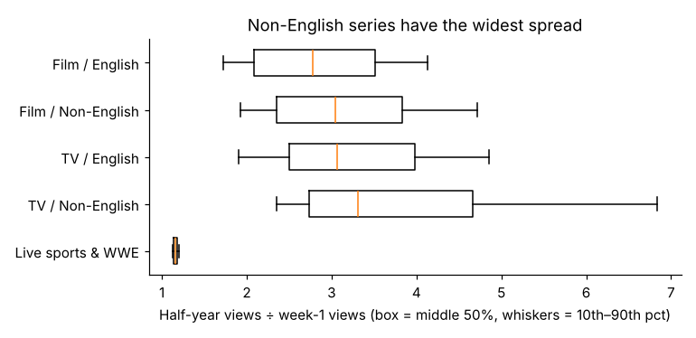
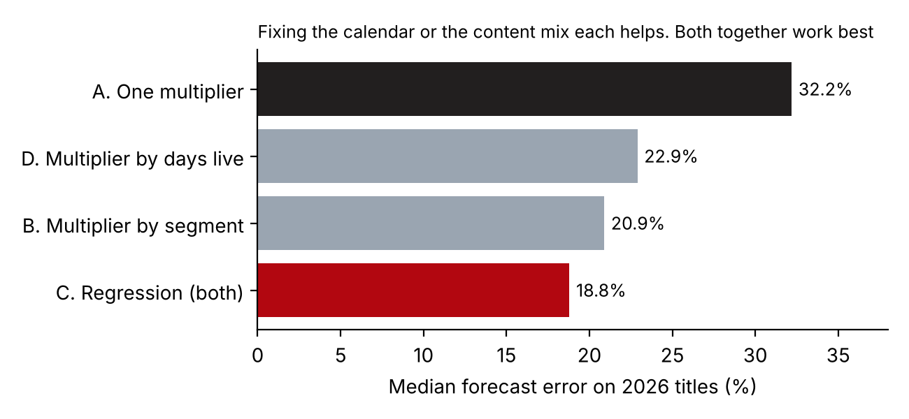

# Is week 1 a good proxy for a Netflix title's success?

A proxy-metric study on Netflix's public viewing data. The question: how well do a title's **week-1 views** predict its **views over the next 3 to 6 months**? Where does that proxy work, where does it break, and how noisy is it?

## Data

All public, all from Netflix:
- **Weekly global Top 10** (`all-weeks-global.tsv`): hours viewed, runtime and views per title per week.
- **What We Watched** engagement reports for **Jul 2024 – Jun 2026** (4 half-years, ~16,000 titles each).

`views` = hours viewed ÷ runtime in both sources. Run `bash get_data.sh` to download the files.

## Method

1. Keep **new releases**: 1,851 titles that premiered inside a report's six months.
2. Match each one to the Top 10. Films match on title, series on show name + season number. Two renamed titles were fixed by hand.
3. **Week 1** = the Mon–Sun Top 10 week that contains the release date.
4. Main sample: 430 titles that were in the Top 10 in their release week and had at least 91 days left in the report window.
5. Test the proxy three ways: rank agreement (Spearman), spread of the multiplier (half-year views ÷ week 1), and an out-of-sample forecast (train on Jul 2024 – Dec 2025, test on Jan – Jun 2026).

## Findings

**1. Week 1 sees half the releases, but most of the viewing.** 47% of new titles made the Top 10 in their release week, and they hold 88% of new-release views. Only ~3% of the top 25% of titles started outside the Top 10, so the proxy rarely misses a big hit.

**2. It ranks films well, and non-English series less well.**

| Segment | Titles | Spearman |
|---|---|---|
| Film / English | 50 | 0.95 |
| Film / Non-English | 93 | 0.88 |
| TV / English | 123 | 0.89 |
| TV / Non-English | 125 | 0.79 |
| Live sports & WWE | 39 | 0.96 |
| **All** | **430** | **0.83** |

**3. As a forecast, it's noisy.** A typical title ends with ~3× its week-1 views. The 10th–90th percentile range is 1.7×–4.2× for English films and 2.4×–7.0× for non-English series. Live sports and WWE end at ~1.2×, because almost all of their viewing happens live.

**4. Days live in week 1 is a built-in bias.** Netflix weeks run Monday to Sunday. Titles with 3 days live in week 1 end at a median 3.75×, while those with 6–7 days end at 2.1×. Each extra day in week 1 lowers the multiplier by ~15%.

**5. Correcting for it cuts forecast error almost in half** (test set: Jan – Jun 2026, 104 titles):

| Forecast | Median abs. % error | Within ±25% | Spearman |
|---|---|---|---|
| A. Week 1 × one multiplier | 32.2% | 44% | 0.82 |
| B. Multiplier by segment | 20.9% | 56% | 0.90 |
| C. Regression (segment + days live + window) | 18.8% | 57% | 0.91 |

Each fix alone (added Nov 24, 2026, notebook section 7b): one multiplier per days-live value gives 22.9%, one per segment 20.9%. Together they do best.

Regression train error is 17.3% vs. 18.8% on test, so it's not overfitting. Holding week 1 fixed, titles with 6 months in the window got only ~5% more views than titles with 3 months, so most viewing happens in the first 3 months.

## What I'd recommend

- Use week 1 to **rank** films early. Use it with caution for non-English series.
- **Normalize week 1 by days live** before comparing titles, or use views per day.
- Report a **range, not a point**, using each segment's multiplier spread.
- Give **live events** their own success metric.

## Limits

- Weekly views exist only for titles in the global Top 10, so small titles are missing from the main sample.
- The outcome window runs 91–184 days, depending on release date (controlled for in the regression).
- Netflix rounds views and hours. Views favor short titles, and hours favor long ones.
- A few renamed titles may still be unmatched.

## Files

- `netflix_week1_proxy.ipynb`: full analysis, with outputs.
- `src/prep.py`: loading, title matching, week-1 logic.
- `get_data.sh`: downloads the 5 Netflix files into `data/`.
- `charts/`: figures used here.
- `medium_post.md`: the blog post.

Author: Faycal Zouine · [Medium](https://medium.com/@faycal.zouine.usa) · [GitHub](https://github.com/ZFayFay)
