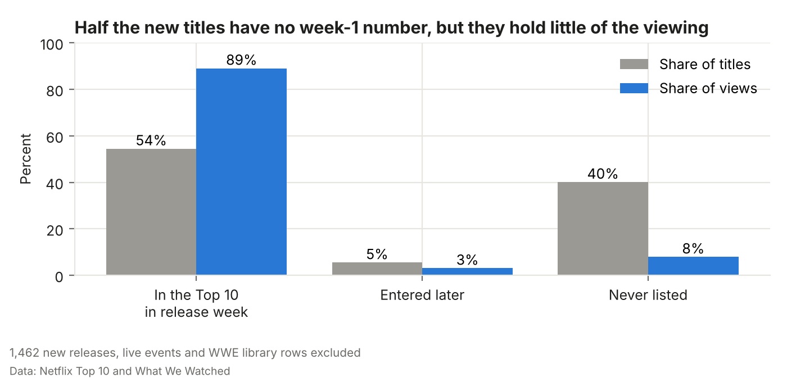
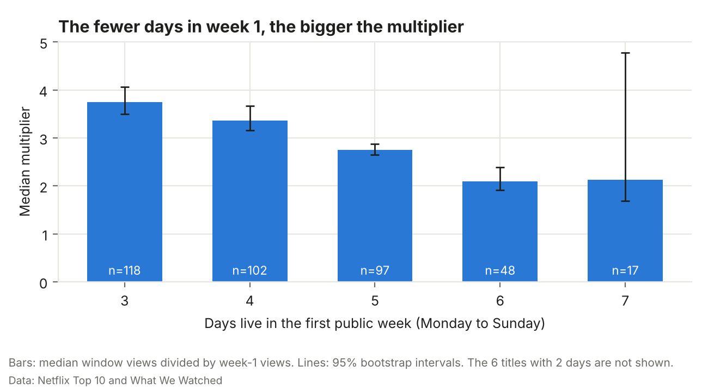
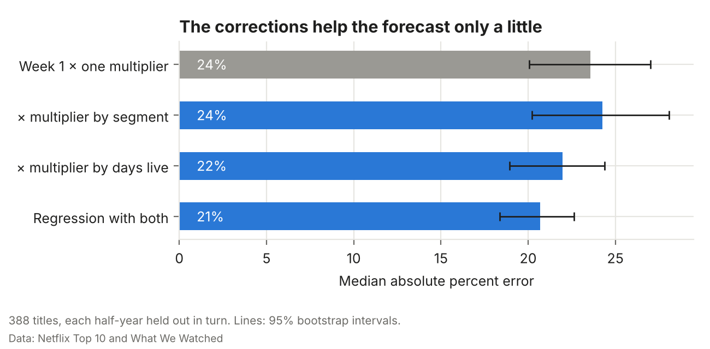

# Netflix's public week-1 number depends on the day a title drops

## I matched 1,851 Netflix releases to the weekly Top 10 and followed 388 of them for three to six months. Week 1 ranks titles well, forecasts them roughly, and understates late-week releases.

Every Tuesday Netflix publishes how many views its new titles got in their first week, and every Tuesday people treat that number as a verdict. I wanted to know how much the public first-week number says about the viewing that follows, so I joined two years of Netflix's public data. Week 1 puts titles in roughly the right order. As a forecast of later viewing it is rough. And it carries a calendar bias: Netflix's public week runs Monday to Sunday, so a Thursday release gets four days in its "week 1" and a Monday release gets seven.

Netflix itself has daily data and can count from the hour a title goes live, so none of this is a problem inside Netflix. It is a problem for the public number that the press, creators and competitors read.

Two real series show the effect. Homicide: Los Angeles came out on a Tuesday and had 4.3 million views in its first week. Leanne came out on a Thursday and had 2.7 million. On week 1, Homicide looks 60% bigger. Over the next five months or so they ended at 12.5 million and 12.0 million. Per day live in that first week they were almost the same, at 0.72 million and 0.68 million. One pair proves nothing, so the rest of this post uses every title I could follow.

## The data

Netflix publishes two datasets that fit together. The weekly global Top 10 gives views for the ten biggest titles on four lists (English films, non-English films, English TV, non-English TV). The What We Watched reports, which have come out every six months so far, give hours and views for every title watched for more than 50,000 hours, about 99% of all viewing. Both define a view as hours watched divided by runtime.

I took the four reports from July 2024 to June 2026 and kept titles that premiered inside each report's window: 1,851 new releases. Then I matched each to the Top 10 week that contains its release date. Matching was the slow part. The same show can be a "Limited Series" in one file and "Season 1" in the other, and three titles were renamed between files, which I fixed by hand.

To compare like with like, I kept titles that made a list in their release week and had at least 91 days left in their report window. That is close to Netflix's own rule for its all-time [Most Popular lists](https://about.netflix.com/en/news/new-top-10-on-netflix), which count a title's first 91 days. My outcome is views over 91 to 184 days, depending on the release date. The rule leaves 430 titles. Forty-two of them are live events, almost all WWE Raw episodes, which get 86% of their viewing in the first week and need their own metric, so I set them aside. That leaves 388.

One catch. For 42 series whose episodes arrive in batches, such as Bridgerton and weekly K-dramas, the Top 10 divides week-1 hours by the runtime released so far, while the report divides by the full season. Their two views numbers are on different scales. Dropping them changes the results little, and I say where it matters.

## Half the titles have no week-1 number, but they are small

Leaving out live events and WWE library rows, 54% of new releases made a list in their release week. Those titles hold 89% of the viewing. Of the top quarter of titles by later views, only 5 of 170 started outside the lists (3%, with a 95% interval of 1% to 7%). Three of the five were released on a Friday. If you rank by hours instead of views the miss rate rises to 9%, because long series rank higher on hours. So week 1 rarely misses a big title.

*Figure 1. Share of new releases, and of their viewing, by when they first reached a weekly list.*

## It ranks titles well, non-English series least well

If all you need is an order, week 1 does well. I measured that with Spearman rank correlation, where 1 means the same order. Between week 1 and the window total it was 0.95 for English films, 0.88 for non-English films, 0.89 for English series and 0.78 for non-English series.

Week 1 is part of the window total, so some of that agreement is built in. Against views after week 1 only, the numbers fall to 0.88, 0.78, 0.78 and 0.68. The order stays the same. Only the gap between English films and non-English series is clearly larger than the noise. Speed is not the reason: in every group, week 1 holds about a third of the window views.

*Figure 2. Week-1 views against views over the window, by segment.*

## As a forecast it's rough

Ranking is the easy job. Forecasting asks how big, not which is bigger. A typical title ends its window with about three times its week-1 views, and it's tempting to multiply everything by three. The spread is the problem. For English films, 80% of titles end between 1.7 and 4.2 times their week 1. For non-English series the range is 2.4 to 7.0 times, so two series with the same first week can end almost three times apart.

*Figure 3. Window views divided by week-1 views. Box: middle 50%. Line: 10th to 90th percentile.*

## The calendar bias

Back to Leanne and Homicide. Titles with three days live in their first week ended at a median 3.75 times their week-1 views. Titles with six days ended at 2.1 times. In a regression that also controls for content type and window length, each extra day lowers the multiplier by about 16% (95% interval 13% to 19%). The effect shows in every content type, from 12% a day for English series to 20% for non-English series, and in each of the four half-years.

*Figure 4. Median multiplier by days live in the first public week, with 95% intervals.*

Because of my 91-day rule, the sample holds almost only titles released in January to March and July to September (423 of 430). So I checked the other half of the calendar. For 311 titles from April to June and October to December, I added the same title's views from the next report to get a longer outcome. The effect was there too, at 20% a day.

This is a pattern in released titles, not an experiment. Netflix chooses the release day, and different kinds of titles favor different days: about half of all films come out on a Friday, while English series lean toward Thursday. A short first week is also mostly a weekend. The data can't separate those two things, but either way the raw week-1 number makes a late-week release look smaller than it is.

## Does correcting for it help?

I scaled each title's week 1 to a seven-day week, using a per-day factor fit on the other three half-years so no title helped correct itself. The ranking improved most where it was weakest. For non-English series the rank correlation rose from 0.78 to 0.85 (gain 0.03 to 0.11), and for non-English films from 0.88 to 0.92.

The forecast improved less. I held out each half-year in turn, fit four forecasts on the other three, and scored all 388 titles. Week 1 times one multiplier had a median error of 24%. A multiplier per content type also got 24%, one per number of days live got 22%, and a regression with both got 21%. The regression comes closest to beating the single multiplier, by about 3 points, and even that is at the edge of the noise.

*Figure 5. Median forecast error, each half-year held out in turn, with 95% intervals.*

My first version of this analysis reported a much bigger forecast gain. It came from WWE Raw episodes in the test set, which one multiplier misses badly and a days-live multiplier fixes by accident, since Raw airs on Mondays. With live events removed, the gain shrank to what you see above.

## What comes after the window

For 297 titles I could look up the same title in the next report. The following six months added a median 14% to the views of the first window (10th to 90th percentile: 8% to 24%). So for titles that open on a list, the first three to six months hold most of the first year. That is not true of the catalog as a whole, where [older titles keep a large share of viewing](https://about.netflix.com/en/news/what-we-watched-the-first-half-of-2025).

## Limits

Weekly views exist only for titles on the global lists, so titles that charted only in their home country are missing. The outcome window runs 91 to 184 days. Views are the only public outcome. They say nothing about cost, completion or retention, and Netflix itself [says](https://about.netflix.com/en/news/what-we-watched-a-netflix-engagement-report) hours alone don't define success. Netflix rounds hours and views, which matters most for small titles. And this is an exploratory analysis: I didn't write hypotheses down before running it.

It is also a test of prediction, not of cause. Netflix's [published work on proxy metrics](https://arxiv.org/abs/2402.17637) asks a harder question: when something moves the early number, does the long-term outcome move too? A big launch push could lift week 1 and leave later viewing where it was. Public data can't answer that.

## What I take from it

The public week-1 number is a fair ranking signal and a weak forecast, and it is tilted by the calendar. If I owned a metric like this, I'd count days since launch instead of calendar weeks, compare a title only with titles of its own type, and report a range rather than a point. In this data, 80% of titles ended between 0.68 and 1.5 times the regression forecast, so a forecast of 32 million means 22 to 48 million. That range is something a team can plan with. I'd also keep live events on their own metric, and keep a short note next to the number saying what it can't see.

You probably have the same problem outside streaming. Any metric counted in calendar weeks or months does: an app feature that ships on a Wednesday, a campaign that starts on the 20th, a store that opens mid-quarter. The first period is short, the number looks small, and someone concludes the launch was weak. Before comparing launches, check how many days each one had.

---

*Code, notebook and charts: [github.com/ZFayFay/netflix-week1-proxy](https://github.com/ZFayFay/netflix-week1-proxy). The data is Netflix's own: the [weekly global Top 10](https://www.netflix.com/tudum/top10) and the What We Watched engagement reports. Any mistakes are mine.*
