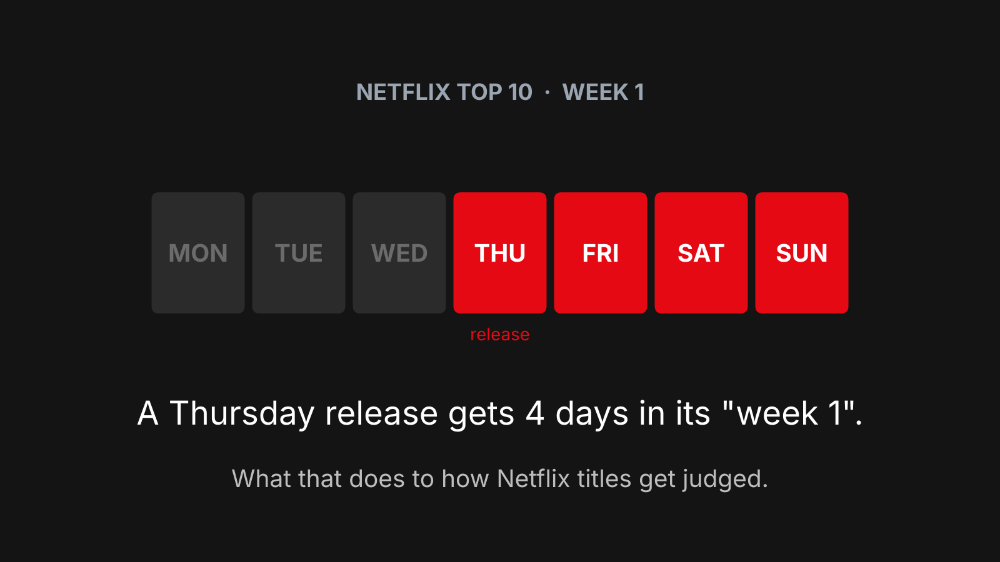
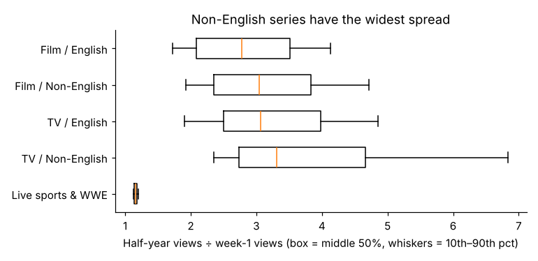
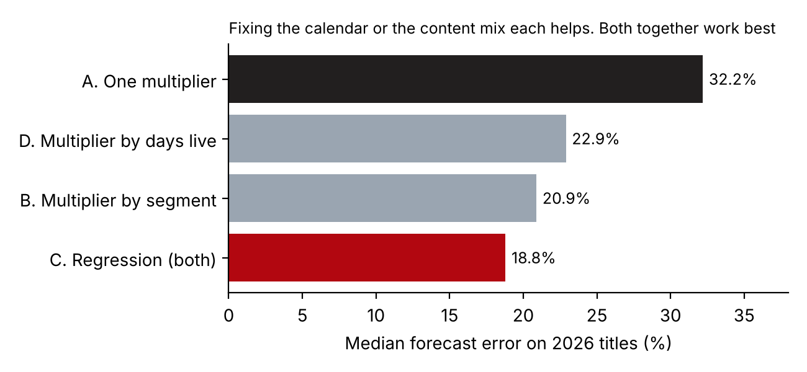

# Is week 1 a good proxy for a Netflix hit? It depends on the day the title drops.

## I compared week 1 with the next 3 to 6 months for 1,851 Netflix releases. It ranks films well, forecasts poorly and favors early-week drops.

You launch something on a Thursday. On Monday your boss asks if it worked.

You can't know yet. The outcome that matters, how much the thing gets used over months, takes months to arrive. So you reach for an early number and hope it tells the truth. For a streaming service that number is week-1 viewing.

I wanted to know how much truth is in it, so I joined two years of Netflix's public viewing data. The short version: week 1 puts films in the right order, it's a noisy forecast, and it's biased by the calendar. Netflix's weeks run Monday to Sunday, so a Thursday release gets four days in its "week 1" and a Monday release gets seven.

Here are two real series. Homicide: Los Angeles opened on a Tuesday with 4.3 million views in its first week. Leanne opened on a Thursday with 2.7 million. On week 1, Homicide looks about 60% bigger. Five months later they had 12.5 million and 12.0 million views. One pair proves nothing, so the rest of this post is the other 1,849 titles.

## The data

Netflix publishes two datasets that fit together. The weekly global Top 10 gives views for the top titles each week. The "What We Watched" engagement reports, published twice a year, give views for nearly every title over six months. Both define a view as hours watched divided by runtime. I took the four reports from July 2024 to June 2026 and kept the titles that premiered inside each report's window: 1,851 new releases. Then I matched each one to the Top 10 week that contains its release date.

Matching was the slow part, as it always is. The same show can be a "Limited Series" in one file and "Season 1" in the other, and a few titles were renamed between files. I matched films on title and series on show name plus season number, and fixed two renamed titles by hand. The main sample is the 430 titles that made the Top 10 in their release week and had at least three months left in their report window.

## Week 1 misses half the titles, but rarely a hit

Only 47% of new releases made the Top 10 in their release week. Those titles hold 88% of all new-release viewing, though. Of the top quarter of titles by six-month views, only about 3% started outside the Top 10. The few it missed include Sakamoto Days, which entered the Top 10 after its first week, and CoComelon Lane, which never did. As a filter for big hits, week 1 works.

*Figure 1. Share of new releases, and of their viewing, by when they first reached the Top 10.*

## It ranks films well and non-English series less well

If all you need is an order, which title is bigger than which, week 1 does well. I measured that with rank correlation (Spearman, where 1 means exactly the same order) between week 1 and the six-month total. It was 0.95 for English films, 0.88 for non-English films, 0.89 for English series and 0.79 for non-English series. Across all 430 titles it was 0.83.

Films get watched fast, so their first week tells most of the story. Non-English series are the hardest to call. My guess is that they build as word of mouth crosses borders, but this data can't show that.

*Figure 2. Week-1 views against views over the report window, by segment.*

## As a forecast, it's noisy

Ranking is the easy job. Forecasting asks more: not which title is bigger, but how big. A typical title ends its window with about three times its week-1 views, and it's tempting to stop there and multiply everything by three. The spread is the problem.

For English films, 80% of titles end between 1.7 and 4.2 times their week 1. For non-English series the range is 2.4 to 7.0 times, so two series with the same first week can end almost three times apart.

Live sports and WWE behave differently. They end at about 1.2 times their week 1, because nearly everyone watches them live, and they need their own measure of success.

*Figure 3. Half-year views divided by week-1 views. Boxes show the 10th to 90th percentile.*

## The calendar bias

Back to Leanne and Homicide. How much of a title's launch counts as "week 1" depends on the day it drops, and the pattern holds well beyond one pair. Titles that were live for three days of their first week ended at a median 3.75 times their week-1 views. Titles live for six or seven days ended at about 2.1 times. In a regression that also controls for content type, each extra day in week 1 lowers the multiplier by about 15%.

*Figure 4. Median multiplier by days live in the first Top 10 week, live events excluded.*

So if you compare raw week-1 numbers, a Thursday release looks weaker than a Monday release with the same audience, only because it had fewer days to count. Nothing about the show is different. The ruler is.

## Two small fixes

How much does this matter in practice? I trained forecasts on releases from July 2024 to December 2025 and tested them on 104 titles from January to June 2026, which the forecasts had never seen.

Multiplying week 1 by one overall multiplier had a median error of 32%. A separate multiplier for each content type cut it to 21%, and a separate one for each number of days live cut it to 23%. A regression with both, plus the length of the outcome window, got to 19%, with 57% of titles within 25% of the truth. Its error on the training years was 17%, close to the test error, so it isn't overfitting.

*Figure 5. Median forecast error on the 104 titles released in 2026.*

The days-live comparison came after my first write-up, when I wanted to know how much of the gain the calendar fix makes on its own. Each fix gets a good part of the way alone, and they work best together. One more result from the regression: holding week 1 fixed, titles with six months in their window got only about 5% more views than titles with three months, so most viewing happens in the first three months.

## Limits

Weekly views exist only for titles that reach the global Top 10, so smaller titles can't be tested this way. The outcome window runs three to six months depending on the release date, which the regression controls for but can't remove. Netflix rounds its numbers, and views (hours divided by runtime) favor short titles. A few renamed titles may still be unmatched. Unlike my other recent posts, I didn't write hypotheses down before running this. It's an exploratory analysis, checked by rerunning it from scratch on freshly downloaded data.

## Why it matters outside Netflix

You probably have this problem too. Any metric counted in calendar weeks or months has it: an app feature that ships on a Wednesday, a campaign that starts on the 20th, a store that opens mid-quarter. The first period is short, the number looks small, and someone concludes the launch was weak.

## What I take from it

A proxy metric is a promise that an early number says something about a later one. Week 1 keeps that promise for films and for spotting hits. It keeps it less well for non-English series, and it quietly breaks it for anything released late in the week.

If I ran this metric, I'd do three things. I'd count days since launch, not calendar weeks. I'd compare a title only with others of its type. And I'd report a range, because "this title will end between 25 and 40 million views" is something a team can plan with, while "32 million" only sounds more precise.

---

*Code, notebook and charts: [github.com/ZFayFay/netflix-week1-proxy](https://github.com/ZFayFay/netflix-week1-proxy). The data is Netflix's own: the [weekly global Top 10](https://www.netflix.com/tudum/top10) and the What We Watched engagement reports. Any mistakes are mine.*
