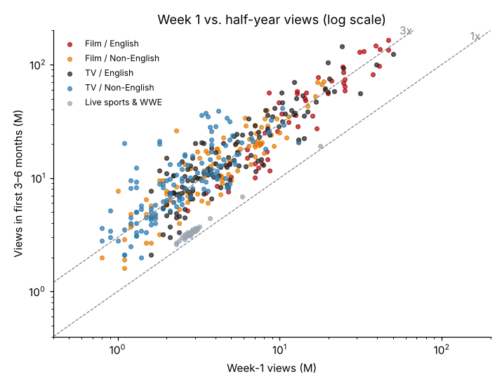

# Is week 1 a good proxy for a Netflix hit? It depends on the day the title drops.

## I compared week 1 with the next 3 to 6 months for 1,851 Netflix releases. It ranks films well, forecasts poorly and favors early-week drops.

Every streaming team has the same problem. A show drops on Thursday, and by Monday someone wants to know if it worked. The outcome that matters, how much it gets watched over months, takes months to arrive, so teams lean on an early number, and week-1 viewing is the obvious one. I wanted to know how good a stand-in it is, so I joined two years of Netflix's public viewing data. Week 1 puts films in the right order, it's a noisy forecast, and it has a calendar bias: Netflix's weeks run Monday to Sunday, so a Thursday release gets four days in its "week 1" and a Monday release gets seven. Correcting for that, and for the type of content, cut the forecast error on titles the model hadn't seen from 32% to 19%.

## The data

Netflix publishes two datasets that fit together. The weekly global Top 10 gives views for the top titles each week. The "What We Watched" engagement reports, published twice a year, give views for nearly every title over six months. Both define a view as hours watched divided by runtime. I took the four reports from July 2024 to June 2026 and kept the titles that premiered inside each report's window: 1,851 new releases. Then I matched each one to the Top 10 week that contains its release date.

Matching was the slow part. The same show can be a "Limited Series" in one file and "Season 1" in the other, and a few titles were renamed between files. I matched films on title and series on show name plus season number, and fixed two renamed titles by hand. The main sample is the 430 titles that made the Top 10 in their release week and had at least three months left in their report window.

## Week 1 misses half the titles, but rarely a hit

Only 47% of new releases made the Top 10 in their release week. Those titles hold 88% of all new-release viewing, though. Of the top quarter of titles by six-month views, only about 3% started outside the Top 10. The few it missed include Sakamoto Days, which entered the Top 10 after its first week, and CoComelon Lane, which never did. As a filter for big hits, week 1 works.

*Figure 1. Share of new releases, and of their viewing, by when they first reached the Top 10.*

## It ranks films well and non-English series less well

Rank correlation (Spearman, where 1 means the same order) between week 1 and the six-month total was 0.95 for English films and 0.88 for non-English films, 0.89 for English series and 0.79 for non-English series. Across all 430 titles it was 0.83. Films get watched fast, so their first week tells most of the story. Non-English series are the hardest to call. My guess is that they build as word of mouth crosses borders, but this data can't show that.

*Figure 2. Week-1 views against views over the report window, by segment.*

## As a forecast, it's noisy

A typical title ends its window with about three times its week-1 views, but the spread matters more than the median. For English films, 80% of titles end between 1.7 and 4.2 times their week 1. For non-English series the range is 2.4 to 7.0 times, so two series with the same first week can end almost three times apart. Live sports and WWE behave differently. They end at about 1.2 times their week 1, because nearly everyone watches them live, and they need their own measure of success.

*Figure 3. Half-year views divided by week-1 views. Boxes show the 10th to 90th percentile.*

## The calendar bias

Netflix's Top 10 weeks run Monday to Sunday, so how much of a title's launch counts as "week 1" depends on the day it drops. Titles that were live for three days of their first week ended at a median 3.75 times their week-1 views. Titles live for six or seven days ended at about 2.1 times. In a regression that also controls for content type, each extra day in week 1 lowers the multiplier by about 15%.

*Figure 4. Median multiplier by days live in the first Top 10 week, live events excluded.*

The consequence is simple. Compare raw week-1 numbers and a Thursday release looks weaker than a Monday release with the same audience, only because it had fewer days to count. Comparing views per day live is a cheap first step.

## Two small fixes

I trained forecasts on releases from July 2024 to December 2025 and tested them on 104 titles from January to June 2026. Multiplying week 1 by one overall multiplier had a median error of 32%. A separate multiplier for each content type cut it to 21%, and a separate one for each number of days live cut it to 23%. A regression with both, plus the length of the outcome window, got to 19%, with 57% of titles within 25% of the truth. Its error on the training years was 17%, close to the test error, so it isn't overfitting.

*Figure 5. Median forecast error on the 104 titles released in 2026.*

The days-live comparison came after my first write-up, when I wanted to know how much of the gain the calendar fix makes on its own. Each fix gets a good part of the way alone, and they work best together. One more result from the regression: holding week 1 fixed, titles with six months in their window got only about 5% more views than titles with three months, so most viewing happens in the first three months.

## Limits

Weekly views exist only for titles that reach the global Top 10, so smaller titles can't be tested this way. The outcome window runs three to six months depending on the release date, which the regression controls for but can't remove. Netflix rounds its numbers, and views (hours divided by runtime) favor short titles. A few renamed titles may still be unmatched. Unlike my other recent posts, I didn't write hypotheses down before running this. It's an exploratory analysis, checked by rerunning it from scratch on freshly downloaded data.

## What I take from it

A proxy metric is a promise that an early number says something about a later one. Week 1 keeps that promise for films and for spotting hits, and keeps it less well for non-English series. The calendar effect is the part I'd fix first, because it's a flaw in how the number is measured rather than in the content, and it's cheap to correct. It's the same question I work on in media measurement, where an early read stands in for an outcome that takes months, and the answer carries over: report a range, not a point. "This title will end between 25 and 40 million views" is something a team can plan with. "32 million" only sounds more precise.

---

*Code, notebook and charts: [github.com/ZFayFay/netflix-week1-proxy](https://github.com/ZFayFay/netflix-week1-proxy). The data is Netflix's own: the [weekly global Top 10](https://www.netflix.com/tudum/top10) and the What We Watched engagement reports. Any mistakes are mine.*
